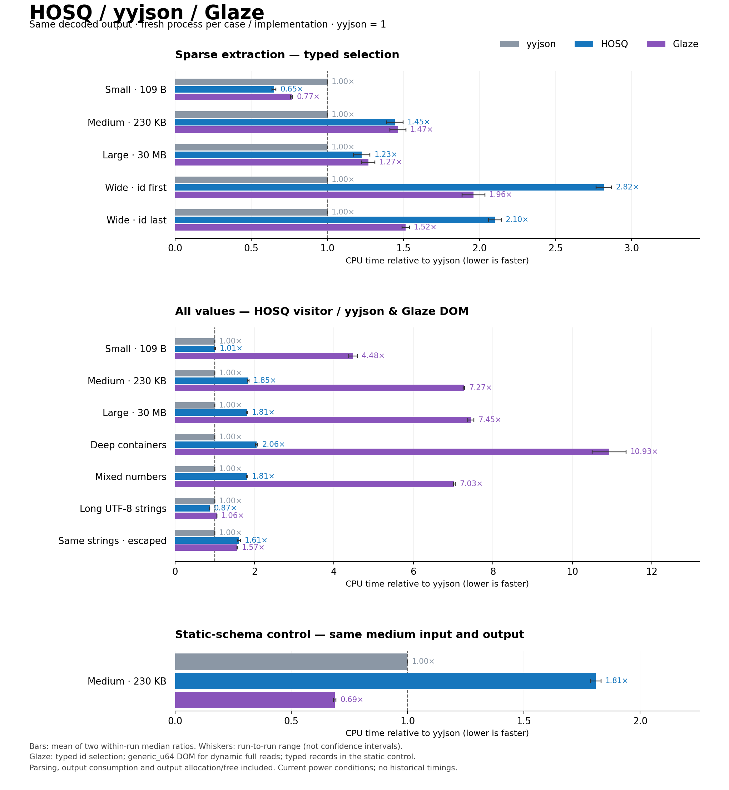

# HOSQ / yyjson / Glaze 比較 — 2026-09-07

同じ12入力を使い、3ライブラリと静的スキーマの対照2つ、計38条件を測定した。
Glazeの汎用DOMと静的読み込みは大きく違うので、結果を分けて解釈する。
DOMはJSON全体をメモリ上の木構造として保持する方式。**HOSQはDOMを作らず、読みながら集計する。**
**230 KBの静的スキーマではGlazeが最速。汎用DOMだけでGlazeの速度を判断してはいけない。**

下表は各測定回のCPU時間中央値を同じ回のyyjsonで割り、2回分の比率を平均したもの。
**小さいほど速い。** グラフのひげは2回の比率の範囲で、信頼区間ではない。
ケースごとの比率を混ぜた総合平均・総合順位は作らない。

| ケース | yyjson | HOSQ | Glaze |
|---|---:|---:|---:|
| 小・109 B／少数取得 | 1.00 | 0.65 | 0.77 |
| 中・230 KB／少数取得 | 1.00 | 1.45 | 1.47 |
| 大・30 MB／少数取得 | 1.00 | 1.23 | 1.27 |
| 幅広いobject／idが先頭 | 1.00 | 2.82 | 1.96 |
| 幅広いobject／idが末尾 | 1.00 | 2.10 | 1.52 |
| 小／全値・汎用 | 1.00 | 1.01 | 4.48 |
| 中／全値・汎用 | 1.00 | 1.85 | 7.27 |
| 大／全値・汎用 | 1.00 | 1.81 | 7.45 |
| 深い構造／全値・汎用 | 1.00 | 2.06 | 10.93 |
| 数値主体／全値・汎用 | 1.00 | 1.81 | 7.03 |
| 長いUTF-8文字列／全値・汎用 | 1.00 | 0.87 | 1.06 |
| 同じ文字列をescape／全値・汎用 | 1.00 | 1.61 | 1.57 |
| 中／全値・静的スキーマ | 1.00 | 1.81 | 0.69 |

## 結果の読み方

- 小さいJSONの少数取得ではHOSQが最速。中・大サイズの少数取得はHOSQとGlazeが近い。
  幅広いobjectではGlazeがHOSQより速いが、yyjsonには届かない。
- 静的スキーマの全値処理では、Glazeはyyjsonの約0.69倍、HOSQの約0.38倍の時間。
  HOSQの静的処理には、この入力でまだ大きな改善余地がある。
- Glazeの汎用DOMが遅い条件は、型付き読み込みが遅いことを意味しない。
  全値・汎用行のGlazeはオブジェクトのキーや値を保持するDOM、HOSQは保持せずに集計する
  汎用visitor、yyjsonはDOMを構築して集計する。これは同じ出力を得る処理全体の比較である。
- 数値主体のHOSQ汎用visitorは整数を試した後、必要ならdoubleへ変換する。
  数値変換器だけの比較、または型を指定した数値pipelineの上限性能ではない。
- 2回間で少数取得などに数%の変動がある。近い値を細かく順位付けしない。
  回内CVの最大は初回約3.5%、再測定約4.9%。CPUコア固定・周波数固定はしていない。

## Glazeをどう使ったか

Glaze **v8.3.0** (`dce5e0f7ec572725ec369a0bc59a00eeb2270a9a`) の
公式ドキュメントと同じ版の実装を確認した。

1. 少数取得は `std::vector<Id>` へ直接読み込む。メンバーは `id` だけを明示的metadataに登録し、
   `error_on_unknown_keys=false` で残りをskipする。
   **`partial_read` は使わない。** 最深objectで早期終了するオプションなので、配列の全要素を
   処理する今回の契約とは違う。
   [公式説明](https://github.com/stephenberry/glaze/blob/v8.3.0/docs/partial-read.md)
2. 汎用の全値処理は `generic_u64`。既定の `generic` は数値がdoubleで、UINT64_MAXを
   含む今回の入力の精度を保てない。`generic_u64` はuint64/int64/doubleを保持する。
   [公式の型選択](https://github.com/stephenberry/glaze/blob/v8.3.0/docs/generic-json.md)
3. 静的対照は、明示的metadataを持つ `std::vector<Record>` へ直接読み込む。
   name/string、count/uint64、ratio/double、ok/bool、none/null、values/array<uint64,4>を使う。
   HOSQ側も既存の静的スキーマで同じ値を集計する。Glazeの固定長4要素に対してHOSQ側は
   整数配列を順に読むため、型表現・検証の細部まで同一という主張はしない。
4. 入力は推奨されるmutable `std::string`。Glaze自身による16バイトの一時的な余白追加と
   サイズ復元を計測内に含める。入力本体は変更されないことを検証した。
   [実装](https://github.com/stephenberry/glaze/blob/v8.3.0/include/glaze/core/read.hpp)
5. minified特化、検証の無効化、出力の事前reserve・再利用は使わない。
   Glazeが標準で行うUTF-8検証と、HOSQのraw string/skipの保証は同一ではない。
   正しいJSONに対して同じ結果を得る比較であり、同じ検証量という意味の公平さではない。

## 測定方法と検証

- HOSQコードは `0aa80e1` 時点から変更なし。Glaze追加を含むベンチだけを変更した。
- yyjson 0.12.0、Glaze v8.3.0、fast_float 8.2.10有効、Google Benchmark 1.9.5。
  Clang 21.1.8、Release `-O3 -DNDEBUG`。C++の両者はGlazeの要件に合わせC++23で再ビルド。
  yyjsonも同じコンパイラでCソースからビルドした。
- 最終測定は**ケースと実装ごとに新しいプロセス**。各プロセスは対象入力だけをロードし、
  対象実装だけをPython由来の期待値と照合してから計測する。
  巨大DOMの解放後のアロケータ状態を別ライブラリへ引き継がない。
- ケース順・同ケース内の実装順をseedで交ぜ、2回実施。各条件5反復、最小0.1秒。
  38条件×5反復×2回＝380サンプル。ビルド・プロファイルを並走させていない。
- 全入力の同一digest、符号付き整数・UINT64_MAX・浮動小数点bits・Unicode文字列を検証。
  Glazeは毎回、消費バイト数が入力長と一致することも確認する。
- 入力の読み込みと生成は計測外。出力のvector/DOMは毎回作成して破棄し、確保・結果取得・
  解放をすべて計測内に含める。HOSQには不要なvectorを追加していない。
- 最終2回の開始・終了時点ではOSが **AC Power / charging** を示した。以前のバッテリー時や
  同一プロセスの診断測定との絶対時間比較はしない。プロセス分離と順序の変更でも、
  測定中の負荷・周波数・スケジューリング変化を完全には除去できない。

[初回の絶対時間表](../bench/comparison/results/2026-09-07-glaze/run1-summary.md)・
[再測定の絶対時間表](../bench/comparison/results/2026-09-07-glaze/run2-summary.md)・
[生データと電源・ビルド記録](../bench/comparison/results/2026-09-07-glaze/)・
[再現手順](../bench/comparison/README.md)。

静的スキーマの差については[追加の原因調査](benchmark-static-gap.md)を参照。
