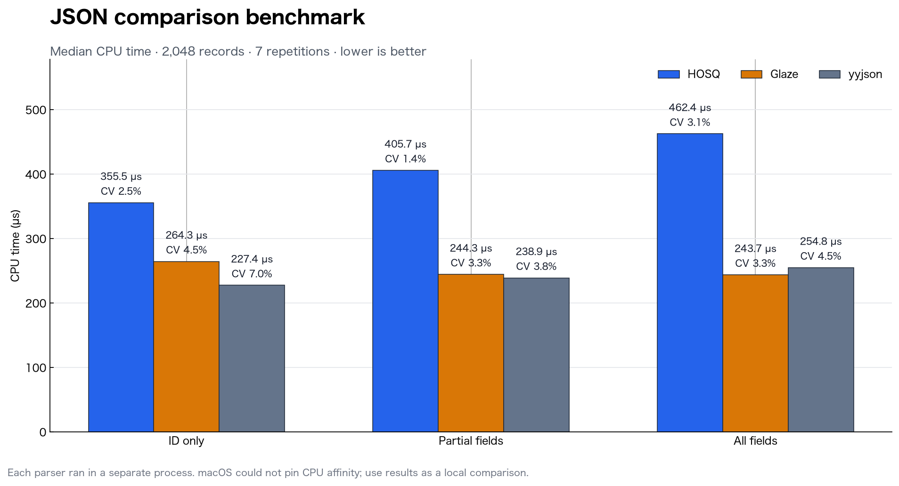

# JSON comparison benchmark — 2026-09-09

Median CPU time for a deterministic, pseudorandom 2,048-record JSON array;
lower is better.
Each parser was measured in a separate process with Google Benchmark 1.9.5,
seven repetitions, and a minimum run time of 0.1 seconds per repetition.

| Case | HOSQ | Glaze | yyjson |
|---|---:|---:|---:|
| ID only | 355.5 µs (CV 2.5%) | 264.3 µs (CV 4.5%) | 227.4 µs (CV 7.0%) |
| Partial fields | 405.7 µs (CV 1.4%) | 244.3 µs (CV 3.3%) | 238.9 µs (CV 3.9%) |
| All fields | 462.4 µs (CV 3.1%) | 243.7 µs (CV 3.4%) | 254.8 µs (CV 4.5%) |

## Scope and fairness

- Each case is a separate source file and executable.
- Every executable uses Google Benchmark directly and registers HOSQ, Glaze,
  and yyjson implementations for the same input.
- HOSQ and Glaze construct typed output. yyjson constructs and frees its DOM.
- Glaze uses its normal mutable-buffer padding path; padding and restoration are
  included in the timed call.
- All three implementations calculate the same checksum from the requested
  values inside the timed region. The checksums are compared before timing.
- The partial-fields case reads `id`, `name`, `count`, `ratio`, and `ok`, while
  ignoring `none` and `values` according to each library's normal mechanism.
- The ID-only case reads `id` and ignores the complete payload.
- The all-fields case reads and validates every member.
- Scalar and array values are generated with a fixed-seed SplitMix64 sequence;
  generation remains outside the timed region.
- Input construction and cross-library verification are outside the timed region.

This is an end-to-end application comparison, not an isolated tokenizer or
schema-dispatch benchmark. macOS reported that CPU affinity could not be set,
so the values should be treated as a local comparison rather than a portable
hardware result.
