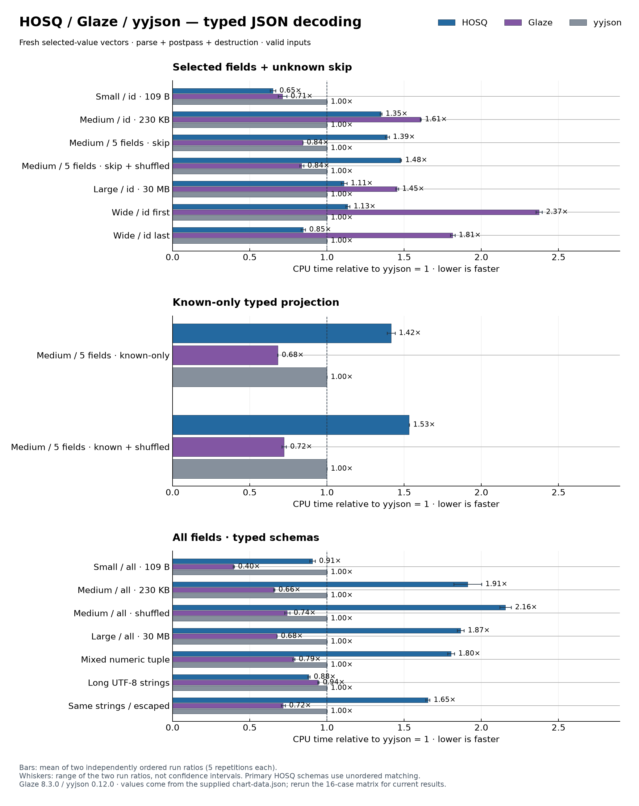

# Typed JSON comparison, 2026-09-09

This chart was generated from two independently ordered runs of the 16-case
typed comparison matrix. Each case/library pair ran in a fresh process with five
Google Benchmark repetitions of at least 0.1 seconds. Both runs used AC power;
the runner seeds were `2026090901` and `2026090902`.

The revised matrix separates five-field projection with unknown members
(`many_skip`) from a known-only wire representation (`many_known`) and includes
deterministically shuffled object-key variants. HOSQ's primary schemas use
unordered constant-key matching in every three-way result.

| Medium case | HOSQ (us) | Glaze (us) | yyjson (us) | HOSQ / yyjson |
|---|---:|---:|---:|---:|
| Five fields, unknown members skipped | 245.752 | 149.212 | 176.774 | 1.390 |
| Five fields, skip + shuffled keys | 325.427 | 184.223 | 220.191 | 1.478 |
| Five fields, known-only wire | 170.399 | 82.049 | 120.432 | 1.415 |
| Five fields, known-only + shuffled keys | 209.984 | 98.906 | 137.027 | 1.532 |
| All fields | 345.083 | 118.710 | 180.609 | 1.911 |
| All fields, shuffled keys | 458.889 | 157.985 | 212.881 | 2.156 |

Times are the mean of the two within-run medians. Ratios are computed within
each run before averaging. Whiskers in the chart show the range of the two run
ratios, not confidence intervals.

These are valid-input, resident-buffer, end-to-end measurements. They include
fresh output allocation, parsing, output consumption, and destruction. yyjson
also builds and frees its DOM. Glaze's read-time padding is timed. Validation
guarantees and memory layouts are not identical. HOSQ projects each decoded
schema object to the shared native record representation inside the timed
pipeline, while Glaze decodes directly into that representation. The chart is
therefore not a parser-only or conformance ranking.
